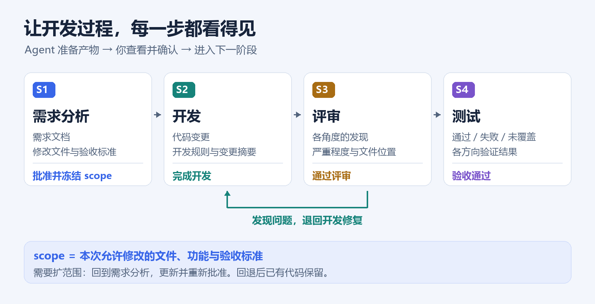
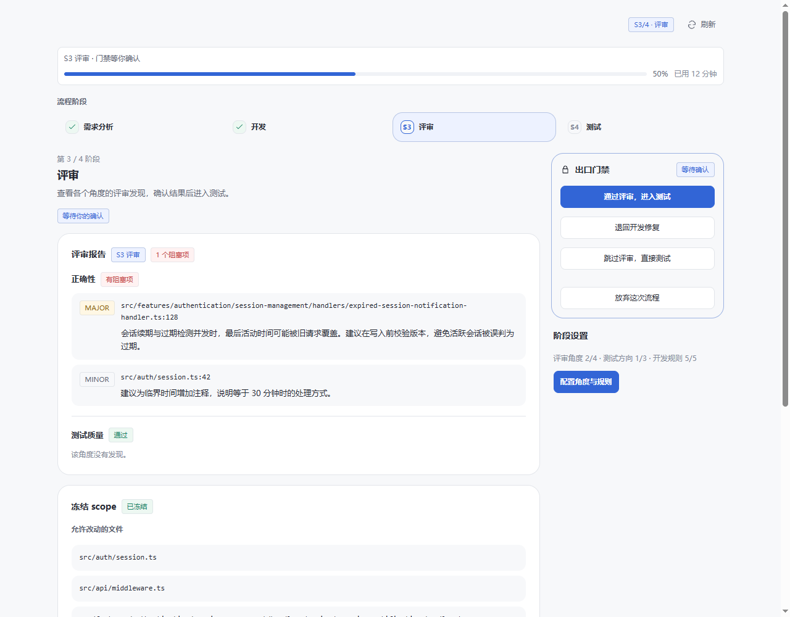

# dsh-flowgate

**DSH 四阶段开发工作台：先确认需求和修改范围，再开发、评审、测试。关键步骤由你点按钮确认。**

适合希望逐步确认 AI 开发过程、控制修改范围的任务。插件提供三件事：

- **看得见进度**：当前阶段、产物和待确认事项集中在工作台。
- **先定范围再修改**：批准后冻结 scope（本次允许修改的文件、功能和验收标准），开发时对已识别的写工具调用检查文件范围。
- **逐步确认结果**：需求、开发、评审和测试各有确认入口；支持退回修复、调整范围和放弃流程。



[安装](#安装) · [快速上手](#快速上手) · [认识工作台](#认识工作台) · [选择档位](#选择档位) · [常见问题](#常见问题) · [开发与维护](docs/development.md)

## 安装

需先有可用的 DSH 环境。插件声明兼容 DSH `>=0.2.1-rc.5 <0.3.0-0`；Node 还需满足所用 DSH 版本的要求。

**CLI / Web profile**：将本项目下载到本地后安装。下面以 `web` profile 为例，请换成你的 profile 和项目绝对路径：

```bash
dsh plugin --profile web add link:D:/Projects/dsh-flowgate
```

**安装后完全退出并重启 DSH 进程**，再打开会话。对话视图顶部应出现「流程工作台」标签，输入框上方会有流程状态条。

**桌面端（desktop profile）**：使用[桌面端安装步骤](docs/development.md#桌面端安装)，安装方式与 CLI profile 不同。

## 快速上手

### 1. 写下要做的事

先为会话绑定项目工作目录，再打开「流程工作台」，填写需求描述，选择档位，点 **「开始需求分析」**。标题可留空，会从需求第一行自动生成。多行输入用 Enter 换行，Ctrl / Cmd + Enter 提交。

例如：

> 会话超过 30 分钟未活动时，接口返回 401，并提供重新认证的入口。

点开始后，这段需求会作为一条消息投递给对话里的 Agent，它会自己进入 S1：先读状态，再逐个问你关键决策，然后提交需求文档。你不用再去对话里补一句。

如果界面提示「没能自动唤醒 Agent」（宿主没有返回该会话的 Agent），在对话里发一句「继续」即可，Agent 会读取 `flowgate_status` 接着做。也可以一开始就在对话里说「用 flowgate 启动四阶段流程，需求是……」，由 Agent 调用 `flowgate_start` 启动。

### 2. 确认需求与修改范围

Agent 有需要你决定的问题时，会在工作台显示选择卡片。选一个方案或填写自定义答案，再查看需求文档、修改文件清单和验收标准。

确认无误后，点 **「批准并冻结 scope」**。这时才进入开发阶段；后续若要修改清单外的文件，需要先回到需求分析、更新范围并重新批准。

### 3. 按阶段检查结果

“门禁”就是每个阶段结束时，等待你确认的操作区。正常流程按下面的顺序推进：

| 阶段 | 你先看什么 | 确认后点什么 |
| :--- | :--- | :--- |
| S1 需求分析 | 需求文档、修改范围、验收标准 | 批准并冻结 scope |
| S2 开发 | 代码变更、开发规则和请求门禁时采集的 Git 摘要 | 完成开发 |
| S3 评审 | 各角度的发现、严重程度与文件位置 | 通过评审，进入测试 |
| S4 测试 | 各验证要点的通过 / 失败 / 未覆盖结果 | 验收通过，结束流程 |

发现问题时，点 **「退回开发修复」**。需要扩充文件范围时，从 S2 点 **「回到需求分析调整 scope」**；若正在评审，先退回 S2。回退后已有代码保留，相关阶段需重新确认。按钮在 Agent 提交对应产物并请求门禁后可用。

评审与测试报告供你判断：查看阻断项、失败项和未覆盖项后，再决定通过、回退或跳过。

## 认识工作台



*这是操作示意图，展示 S1 文档待确认时的主要区域；实际界面会随阶段、窗口宽度和 DSH 主题变化。*

- **左侧看进度**：显示四个阶段及状态，不能靠点击导航直接跳转阶段。
- **中间看产物**：按阶段显示问题卡片、需求预览、开发变更、评审报告或测试结果。
- **右侧做决定**：上方是「出口门禁」，下方是「阶段设置」，可调整开发规则、评审角度和测试方向。

窄窗口会调整布局；在对话标签中也能通过输入框上方的状态条查看当前阶段和待确认状态。

## 选择档位

| | 小功能快速开发（默认） | 大需求严格执行 |
| :--- | :--- | :--- |
| 适合 | 小范围修改、简单功能 | 多模块变更、需要更充分检查的需求 |
| 评审角度 | 正确性、测试质量 | 安全、正确性、测试质量、风格 |
| 测试方向 | 冒烟验证 | 功能正确性、边界与异常、回归影响 |
| 需求追问 | 较浅 | 较深 |

两档都走同样的四阶段流程。你可以在「阶段设置」中勾选或追加检查项；中途升档不会自动扩大修改范围。升档触发回退的规则见[进阶说明](docs/development.md#升档与回退)。

## 常见问题

**门禁显示“准备中”，按钮点不了？**

Agent 还没有提交对应产物或请求门禁。回到对话让它继续当前阶段；工具等待你确认时，再到工作台操作。

**提示“文件不在冻结 scope 内”？**

先回到需求分析，将该文件加入范围并重新批准。S2 的变更性 shell 命令也会被拦截，文件修改应走受检查的写入 / 编辑工具。具体边界见[权限说明](docs/development.md#修改范围与只读边界)。

**“跳过”和“放弃”有什么区别？**

“跳过”略过当前确认门禁并留下标记：S1 仍冻结 scope 后进入开发，S2 进入评审，S3 进入测试，S4 直接结束流程；不等同于报告通过。

“放弃这次流程”需要二次确认，会结束整条流程、解除本流程的 scope 约束并清除测试写授权。已有代码和历史记录保留，正在运行的任务需另行停止。

**完成或放弃后，怎样再开一条流程？**

当前版本可在同一会话中告诉 Agent：「请调用 flowgate_start，启动新流程，需求是……」。

**评审一定由独立子代理完成吗？**

宿主支持 `subagents` 服务时，可以按角度启动只读评审子代理；不支持时，由当前 Agent 提交结构化报告。两种方式都需你在门禁确认。

**安装后没有看到入口？**

先确认已完全重启 DSH，并安装到了当前使用的 profile。在项目目录运行 `npm run test:install` 检查桌面端安装；其他 profile 需设置 `FLOWGATE_PROFILE_DIR`。更多情况见[排障说明](docs/development.md#排障)。

**流程记录存在哪里？**

工作区的 `.dsh-flowgate/` 中保存修改范围、流程快照和事件日志：

```text
.dsh-flowgate/
  scope.json            # 修改范围及冻结状态
  flows/<flowId>.json   # 单条流程快照
  flows.jsonl           # 门禁、跳过、回退、升档等事件
```

## 更多资料

- [开发与维护](docs/development.md)：桌面端安装、权限边界、工具索引、测试与排障。
- [验证记录](docs/verification.md)：此前实机验证的环境、结果与已修复问题。
- [更新记录](CHANGELOG.md) · [MIT 许可](LICENSE)。

文档编排参考了 [dsh-plugin-hub](https://github.com/wingsky-1/dsh-plugin-hub) 的快速导航与分层说明，以及 [my-dsh-plugins](https://github.com/baosfeng/my-dsh-plugins) 的图片导览方式；本文插图为本项目自行绘制。
